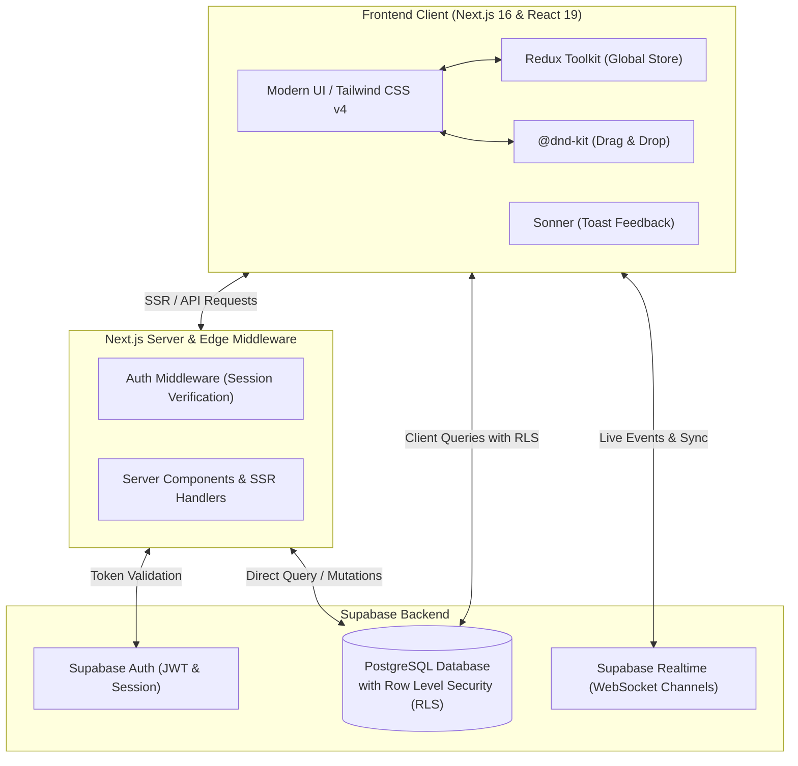

<div align="center">


<br/>

[](https://wasifworkspace.vercel.app)
[](https://github.com/wasifalidev/Workspace-Hackathon/stargazers)
[](https://github.com/wasifalidev/Workspace-Hackathon/network)
[](LICENSE)

<br/>

[](https://nextjs.org/)
[](https://react.dev/)
[](https://www.typescriptlang.org/)
[](https://tailwindcss.com/)
[](https://supabase.com/)
[](https://redux-toolkit.js.org/)

</div>

---

> ⭐ **If this project helps you or inspires you — please give it a star! It keeps me motivated to build more open-source tools.** ⭐

---

## ✨ What Is This?

**Wasif's Workspace** is an enterprise-grade, open-source project management platform built for high-velocity engineering, design, and operations teams. Engineered from the ground up with **Next.js 16 (App Router)**, **React 19**, **Tailwind CSS v4**, and **Supabase** — it delivers frictionless task tracking, live multi-user synchronization, and workspace switching in a polished dark-mode interface.

🔗 **Live:** [wasifworkspace.vercel.app](https://wasifworkspace.vercel.app) | 📦 **Repo:** [Workspace-Hackathon](https://github.com/wasifalidev/Workspace-Hackathon)

---

## 🚀 Features

| | Feature | Description |
|:---:|---|---|
| 🏢 | **Universal Workspace Switcher** | Seamlessly switch between multiple workspaces and organizations without losing state |
| 📋 | **Interactive Kanban Board** | Smooth drag-and-drop task workflows powered by `@dnd-kit` with swimlanes & priority indicators |
| 📝 | **Multi-View Project Modes** | Toggle between **Kanban Board**, **Structured List**, and **Calendar View** instantly |
| ⚡ | **Real-Time Live Sync** | Instant collaboration via **Supabase Realtime WebSockets** — see updates as they happen |
| 🎯 | **"My Tasks" Focus Engine** | Unified personal task aggregator across all projects in one high-priority dashboard |
| 📊 | **Analytics & Admin Hub** | Track velocity, milestone progress, deliverables, and manage roles with fine-grained control |
| 🛡️ | **Enterprise RLS Security** | Row-Level Security in PostgreSQL ensuring strict multi-tenant isolation per workspace |
| 🎨 | **Modern Dark Aesthetics** | Glassmorphism UI, glowing nav indicators, micro-animations, and a responsive design system |
| 🔔 | **Notification System** | Real-time mention and assignment alerts with read status and actionable deep links |
| 🔐 | **Supabase Auth** | JWT-based authentication with middleware-protected routes and session refresh |

---

## 🏗️ Architecture

A modern decoupled full-stack architecture combining server-side rendering, client state management, and real-time database reactivity:



---

## ⚙️ Quick Start

### 1. Prerequisites

- [Node.js](https://nodejs.org/) v18.18+ or v20+
- [npm](https://www.npmjs.com/), [pnpm](https://pnpm.io/), or [bun](https://bun.sh/)
- A free [Supabase](https://supabase.com/) account and project

### 2. Clone the Repository

```bash
git clone https://github.com/wasifalidev/Workspace-Hackathon.git
cd Workspace-Hackathon
```

### 3. Install Dependencies

```bash
npm install
```

### 4. Configure Environment Variables

```bash
cp .env.example .env.local
```

Fill in your Supabase credentials in `.env.local`:

```env
NEXT_PUBLIC_SUPABASE_URL=https://your-project-id.supabase.co
NEXT_PUBLIC_SUPABASE_ANON_KEY=your-anon-key-here
```

> **Note:** Find these in your **Supabase Dashboard → Project Settings → API**. Never expose the `service_role` key on the client side.

### 5. Initialize the Database Schema

Run the SQL migration scripts from the `sql/` directory in your Supabase SQL Editor:

1. Execute `sql/000_full_schema.sql` (or run individual files `001` → `020` in order)
2. Verify that tables (`workspaces`, `projects`, `tasks`, `profiles`, etc.) and RLS policies are created successfully

### 6. Launch the Dev Server

```bash
npm run dev
```

Open [http://localhost:3000](http://localhost:3000) and start building! 🎉

---

## 📂 Project Structure

```text
Wasif's Workspace/
├── 📁 app/                     # Next.js 16 App Router pages and layouts
│   ├── 📁 (app)/               # Authenticated application shell
│   │   ├── 📁 [workspace]/     # Workspace routes ([project], tasks, board, etc.)
│   │   │   └── 📁 [project]/   # Project views: board, list, calendar
│   │   ├── 📁 admin/           # Administrative controls & analytics
│   │   ├── 📁 dashboard/       # Main workspace dashboard
│   │   ├── 📁 my-tasks/        # Consolidated personal tasks
│   │   ├── 📁 notifications/   # Activity alerts & notification feed
│   │   ├── 📁 settings/        # User & workspace settings
│   │   └── 📁 workspaces/      # Workspace directory & management
│   ├── 📁 (auth)/              # Authentication screens (login, register)
│   ├── 📁 auth/                # Auth callback handlers
│   ├── 📄 layout.tsx           # Root layout with top progress bar & font setup
│   └── 📄 page.tsx             # Landing hero & feature showcase
├── 📁 components/              # Modular, reusable UI component library
│   ├── 📁 dashboard/           # Metrics cards, charts, and velocity widgets
│   ├── 📁 layout/              # Sidebar, Header, Breadcrumbs, Navigation
│   ├── 📁 providers/           # Redux, Auth, and Theme providers
│   ├── 📁 tasks/               # Kanban board, Task cards, Task modal dialogs
│   └── 📁 ui/                  # Buttons, Inputs, Badges, Modals, Logo
├── 📁 lib/                     # Utilities & external client configurations
│   ├── 📁 supabase/            # Browser, Server, and Middleware Supabase clients
│   └── 📁 utils/               # Formatting, date helpers, classnames
├── 📁 sql/                     # PostgreSQL migrations, RLS policies, & triggers
│   ├── 📄 000_full_schema.sql  # Complete schema migration
│   ├── 📄 015_rls_policies.sql # Multi-tenant security rules
│   └── 📄 016_functions_triggers.sql # Automated triggers & audit logs
├── 📁 store/                   # Redux Toolkit state slices & root store
├── 📁 public/                  # Static assets (brand logos, icons, favicon)
├── 📄 middleware.ts            # Route protection and Supabase session refresh
├── 📄 next.config.ts           # Next.js build and image optimization config
└── 📄 package.json             # Dependencies and build scripts
```

---

## 🗄️ Database & Security

PostgreSQL with **Row Level Security (RLS)** enforces strict workspace isolation across all tenants:

| Entity | Description | Key Features |
| :--- | :--- | :--- |
| **`profiles`** | User metadata & settings | Auto-synced with Supabase Auth |
| **`workspaces`** | Multi-tenant organization containers | Unique slugs, avatars, ownership |
| **`workspace_members`** | Role-based access control | `owner`, `admin`, `member`, `viewer` |
| **`projects`** | Workspace sub-initiatives | Status tracking, colors, deadlines |
| **`tasks`** | Actionable project tasks | Status swimlanes, priorities, assignees |
| **`subtasks`** | Granular task checklists | Checked status, ordering |
| **`activity_logs`** | Real-time audit timeline | Comprehensive action tracking |
| **`notifications`** | Mention and assignment alerts | Read status, actionable links |

---

## 🛠️ Tech Stack

| Layer | Technology |
|---|---|
| **Framework** | [Next.js 16.3.4](https://nextjs.org/) — App Router, RSC, SSR |
| **UI Runtime** | [React 19.2](https://react.dev/) |
| **Language** | [TypeScript 5](https://www.typescriptlang.org/) |
| **Styling** | [Tailwind CSS v4](https://tailwindcss.com/) with custom dark design tokens |
| **Database & Auth** | [Supabase](https://supabase.com/) — PostgreSQL + RLS + Realtime WebSocket |
| **State Management** | [Redux Toolkit](https://redux-toolkit.js.org/) + [React Redux](https://react-redux.js.org/) |
| **Drag & Drop** | [@dnd-kit/core](https://dndkit.com/) & [@dnd-kit/sortable](https://dndkit.com/) |
| **Notifications** | [Sonner](https://sonner.emilkowal.ski/) |
| **Date Handling** | [date-fns](https://date-fns.org/) |
| **Icons** | [Lucide React](https://lucide.dev/) + [Google Material Symbols](https://fonts.google.com/icons) |

---

## 💻 Scripts

| Command | Action |
| :--- | :--- |
| `npm run dev` | Start local dev server at `http://localhost:3000` |
| `npm run build` | Compile optimized production bundle |
| `npm run start` | Run the compiled production server |
| `npm run lint` | Check codebase for ESLint warnings and errors |

---

## 🤝 Contributing

Contributions, issues, and feature requests are very welcome! This is an **open-source** project — feel free to build on top of it.

```bash
# 1. Fork the repo on GitHub
# 2. Create your feature branch
git checkout -b feature/your-feature-name

# 3. Commit your changes
git commit -m "feat: add your feature"

# 4. Push to your fork
git push origin feature/your-feature-name

# 5. Open a Pull Request 🚀
```

**Ideas for contributions:**
- 🌍 i18n / Multi-language support
- 📱 Mobile-responsive Kanban improvements
- 🤖 AI-powered task suggestions
- 📈 Advanced analytics & reporting dashboard
- 🔗 Slack / Discord webhook integrations

---

## 📄 License

This project is open-source and available under the **MIT License** — use it freely in personal and commercial projects.

---

## ⭐ Show Your Support

<div align="center">

**If Wasif's Workspace saved you time, gave you ideas, or helped you learn — a star goes a long way!**

[](https://github.com/wasifalidev/Workspace-Hackathon/stargazers)
[](https://github.com/wasifalidev/Workspace-Hackathon/fork)
[](https://wasifworkspace.vercel.app)

> Stars help this project reach more developers. It takes 1 second and means everything! 🙏

</div>

---

## 👨‍💻 About the Author

<div align="center">

**Wasif Ali** — Web & App Developer | Founder of Developers Tech

*"Turning Ideas into Real Applications"*

[](https://wasifalidev.netlify.app)
[](https://developerstech.netlify.app)
[](mailto:mianwasifdev@gmail.com)
[](https://linkedin.com/in/wasifalidev)
[](https://instagram.com/wasifali.dev)
[](https://github.com/wasifalidev)

</div>

---

<div align="center">


⭐ **Loved the project? Drop a star — it motivates me to keep building!** ⭐

*Made with ❤️ by [Wasif Ali](https://github.com/wasifalidev) — Pakistan 🇵🇰*

</div>

---

## 🌟 Overview

**Wasif's Workspace** is an enterprise-grade project management platform engineered for high-velocity software engineering, design, and operations teams. Built from the ground up with **Next.js 16 (App Router)**, **React 19**, **Tailwind CSS v4**, and **Supabase**, it delivers frictionless task tracking, live multi-user synchronization, and workspace switching in a sleek dark-mode interface.

---

## ✨ Core Features

<table>
  <tr>
    <td width="50%">
      <h3>🏢 Universal Workspace Switcher</h3>
      <p>Seamlessly switch between multiple workspaces, organizations, and projects without losing your context or state.</p>
    </td>
    <td width="50%">
      <h3>📋 Interactive Kanban Board</h3>
      <p>Smooth drag-and-drop task workflows powered by <code>@dnd-kit</code> with swimlanes, priority indicators, and member assignments.</p>
    </td>
  </tr>
  <tr>
    <td width="50%">
      <h3>📝 Multi-View Project Modes</h3>
      <p>Toggle instantly between <b>Kanban Board</b>, <b>Structured List</b>, and <b>Calendar View</b> to visualize sprints your way.</p>
    </td>
    <td width="50%">
      <h3>⚡ Real-Time Live Sync</h3>
      <p>Instant collaboration backed by <b>Supabase Realtime WebSockets</b> — see task movements and status updates across devices as they happen.</p>
    </td>
  </tr>
  <tr>
    <td width="50%">
      <h3>🎯 "My Tasks" Focus Engine</h3>
      <p>A unified personal task aggregator gathering assignments across all projects into a single high-priority dashboard.</p>
    </td>
    <td width="50%">
      <h3>📊 Analytics & Admin Hub</h3>
      <p>Track team velocity, milestone progress, completed deliverables, and manage workspace members with fine-grained roles.</p>
    </td>
  </tr>
  <tr>
    <td width="50%">
      <h3>🛡️ Enterprise Security & RLS</h3>
      <p>Robust Row-Level Security (RLS) in PostgreSQL ensuring strict multi-tenant isolation and workspace permission integrity.</p>
    </td>
    <td width="50%">
      <h3>🎨 Modern Dark Aesthetics</h3>
      <p>A curated dark-mode design system with glowing navigation progress indicators, micro-animations, glassmorphism, and responsive layouts.</p>
    </td>
  </tr>
</table>

---

## 🏗️ Architecture

The system is designed with a modern decoupled full-stack architecture combining server-side rendering, client state management, and real-time database reactivity:


---

## 🚀 Quick Start

### 1. Prerequisites

Ensure you have the following installed:
- [Node.js](https://nodejs.org/) (v18.18+ or v20+ recommended)
- [npm](https://www.npmjs.com/), [pnpm](https://pnpm.io/), or [bun](https://bun.sh/)
- A free [Supabase](https://supabase.com/) account and project

### 2. Clone the Repository

```bash
git clone https://github.com/wasifalidev/Workspace-Hackathon.git
cd Workspace-Hackathon
```

### 3. Install Dependencies

```bash
npm install
```

### 4. Configure Environment Variables

Duplicate `.env.example` into `.env.local`:

```bash
cp .env.example .env.local
```

Fill in your Supabase credentials:

```env
# Supabase Configuration
NEXT_PUBLIC_SUPABASE_URL=https://your-project-id.supabase.co
NEXT_PUBLIC_SUPABASE_ANON_KEY=your-anon-key-here
```

> [!NOTE]
> You can retrieve these credentials in your **Supabase Dashboard** under **Project Settings > API**. Never expose the `service_role` key in client environment variables.

### 5. Initialize the Database Schema

Run the SQL migration scripts located in the `sql/` directory in your Supabase SQL Editor:

1. Execute [`sql/000_full_schema.sql`](sql/000_full_schema.sql) (or run the individual numbered migration files from `001` to `020`).
2. Verify that tables (`workspaces`, `projects`, `tasks`, `profiles`, etc.) and RLS policies are created successfully.

### 6. Launch the Development Server

```bash
npm run dev
```

Open [http://localhost:3000](http://localhost:3000) in your browser to start exploring!

---

## 📂 Project Structure

```text
Wasif's Workspace/
├── 📁 app/                     # Next.js 16 App Router pages and layouts
│   ├── 📁 (app)/               # Authenticated application shell
│   │   ├── 📁 [workspace]/     # Workspace routes ([project], tasks, board, etc.)
│   │   │   └── 📁 [project]/   # Project views: board, list, calendar
│   │   ├── 📁 admin/           # Administrative controls & analytics
│   │   ├── 📁 dashboard/       # Main workspace dashboard
│   │   ├── 📁 my-tasks/        # Consolidated personal tasks
│   │   ├── 📁 notifications/   # Activity alerts & notification feed
│   │   ├── 📁 settings/        # User & workspace settings
│   │   └── 📁 workspaces/      # Workspace directory & management
│   ├── 📁 (auth)/              # Authentication screens (login, register)
│   ├── 📁 auth/                # Auth callback handlers
│   ├── 📄 layout.tsx           # Root layout with top progress bar & font setup
│   └── 📄 page.tsx             # Landing hero & feature showcase
├── 📁 components/              # Modular, reusable UI component library
│   ├── 📁 dashboard/           # Metrics cards, charts, and velocity widgets
│   ├── 📁 layout/              # Sidebar, Header, Breadcrumbs, Navigation
│   ├── 📁 providers/           # Redux, Auth, and Theme providers
│   ├── 📁 tasks/               # Kanban board, Task cards, Task modal dialogs
│   └── 📁 ui/                  # Buttons, Inputs, Badges, Modals, Logo
├── 📁 lib/                     # Utilities & external client configurations
│   ├── 📁 supabase/            # Browser, Server, and Middleware Supabase clients
│   └── 📁 utils/               # Formatting, date helpers, classnames
├── 📁 sql/                     # PostgreSQL migrations, RLS policies, & triggers
│   ├── 📄 000_full_schema.sql  # Complete schema migration
│   ├── 📄 015_rls_policies.sql # Multi-tenant security rules
│   └── 📄 016_functions_triggers.sql # Automated triggers & audit logs
├── 📁 store/                   # Redux Toolkit state slices & root store
├── 📁 public/                  # Static assets (brand logos, icons, favicon)
├── 📄 middleware.ts            # Route protection and Supabase session refresh
├── 📄 next.config.ts           # Next.js build and image optimization config
└── 📄 package.json             # Dependencies and build scripts
```

---

## 🗄️ Database & Security Architecture

The platform uses a relational PostgreSQL schema with **Row Level Security (RLS)** to enforce strict workspace isolation:

| Entity | Description | Key Features |
| :--- | :--- | :--- |
| **`profiles`** | User metadata & settings | Auto-synced with Supabase Auth |
| **`workspaces`** | Multi-tenant organization containers | Unique slugs, avatars, ownership |
| **`workspace_members`**| Role-based access control | `owner`, `admin`, `member`, `viewer` |
| **`projects`** | Workspace sub-initiatives | Status tracking, colors, deadlines |
| **`tasks`** | Actionable project tasks | Status swimlanes, priorities, assignees |
| **`subtasks`** | Granular task checklists | Checked status, ordering |
| **`activity_logs`** | Real-time audit timeline | Comprehensive action tracking |
| **`notifications`** | Mention and assignment alerts | Read status, actionable links |

---

## 🛠️ Tech Stack & Libraries

- **Framework**: [Next.js 16.3.4](https://nextjs.org/) with React Server Components & App Router
- **Runtime & UI**: [React 19.2.8](https://react.dev/)
- **Styling**: [Tailwind CSS v4](https://tailwindcss.com/) with custom dark design tokens
- **Database & Auth**: [Supabase](https://supabase.com/) (PostgreSQL + RLS + Realtime WebSocket)
- **State Management**: [Redux Toolkit](https://redux-toolkit.js.org/) + [React Redux](https://react-redux.js.org/)
- **Drag & Drop**: [@dnd-kit/core](https://dndkit.com/) & [@dnd-kit/sortable](https://dndkit.com/)
- **Notifications**: [Sonner](https://sonner.emilkowal.ski/)
- **Date Handling**: [date-fns](https://date-fns.org/)
- **Icons**: [Google Material Symbols](https://fonts.google.com/icons)

---

## 💻 Available Scripts

| Command | Action |
| :--- | :--- |
| `npm run dev` | Starts local Next.js development server at `http://localhost:3000` |
| `npm run build` | Compiles optimized production bundle |
| `npm run start` | Runs the compiled production server |
| `npm run lint` | Checks codebase for ESLint warnings and errors |

---

## 🤝 Contributing

Contributions, issues, and feature requests are welcome!

1. Fork the Project
2. Create your Feature Branch (`git checkout -b feature/AmazingFeature`)
3. Commit your Changes (`git commit -m 'feat: Add some AmazingFeature'`)
4. Push to the Branch (`git push origin feature/AmazingFeature`)
5. Open a Pull Request

---

## 👤 Author

**Wasif Ali**
- GitHub: [@wasifalidev](https://github.com/wasifalidev)
- Repository: [Workspace-Hackathon](https://github.com/wasifalidev/Workspace-Hackathon)
- Email: [mianwasifdev@gmail.com](mailto:mianwasifdev@gmail.com)

---

## 📄 License

This project is licensed under the MIT License — see the [LICENSE](LICENSE) file for details.

<div align="center">
  <sub>Built with ❤️ for productive teams by Wasif Ali.</sub>
</div>
